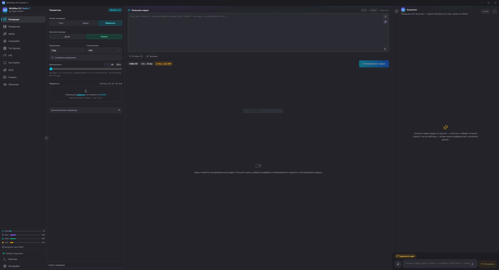
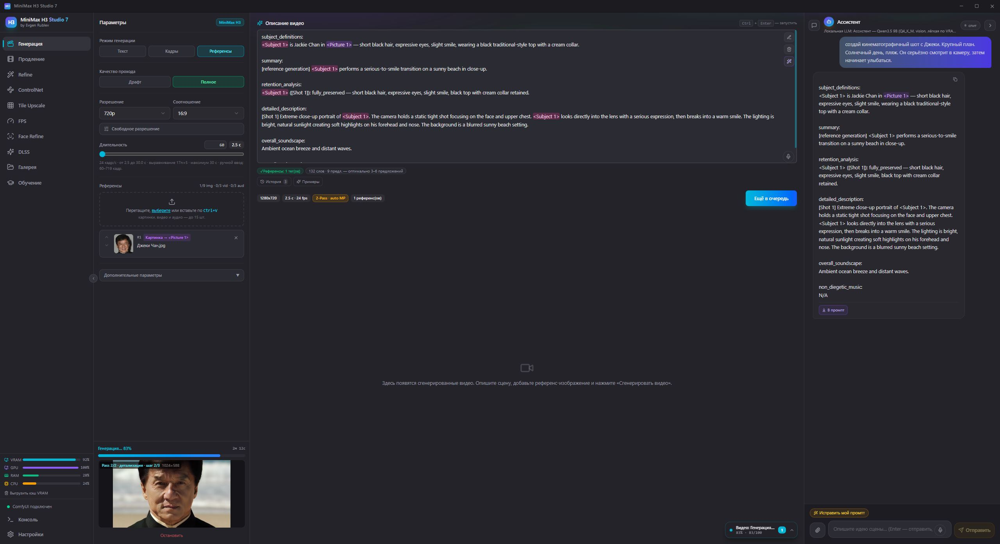

# MiniMax H3 Studio 7

Local web interface for generating cinematic videos with synchronized audio powered by the **MiniMax H3** model. Operates completely offline — requires only an NVIDIA GPU.

| | |
| --- | --- |
| **Version** | 7.0.0 |
| **Platform** | Windows 10/11 x64 |
| **Operation Mode** | Fully local, no cloud, no telemetry |
| **Requirements** | NVIDIA GPU with 8+ GB VRAM (12+ GB recommended), CUDA 12.x driver |
| **Launch** | `start.bat` — single file entry point, zero installation |

> **Status:** Project released. Installation from source — via `install.bat`,
> verification of local build — via `npm run release`
> (clean → typecheck → build → prune → prepare → verify). Details in
> the [Release Build](#release-build) section.

## Screenshots

| Main Window | Reference Generation | Result Lightbox |
| :---: | :---: | :---: |
| [](screenshots/main-window.jpg) | [](screenshots/reference-generation.jpg) | [](screenshots/result-lightbox.jpg) |

## Installation on a New Machine

If the project was **cloned from GitHub** (i.e. without `node_modules`,
`ComfyUI-Easy-Install`, `runtime`, and other heavy folders — which are omitted from
the repository), the entire environment is installed with a single file:

```
install.bat
```

The installer script downloads and configures:

| Component | Version |
| --- | --- |
| ComfyUI | build `5f0c4e1` (25.08.2026) + 4 project patches |
| Python | 3.12.10 (embedded) |
| torch / torchvision / torchaudio | 2.11.0+cu130 / 0.26.0 / 2.11.0 |
| Python packages | 288 pinned working environment versions |
| Custom nodes | 22 pinned commit nodes + 4 internal custom nodes |
| Node.js | 22.20.0 (portable, if system lacks 18+) |
| Electron | 44.9.0 (native desktop window, not a browser) |

Downloads ~9 GB, installation takes 20–60 minutes depending on internet connection speed.
Requires **25 GB** of free disk space.

**Model weights are not downloaded automatically** — after installation launch `start.bat`
and download them via UI: Settings → Models.

> **What is not restored:** The folders `upscale/bin` (DLSS 5, ~1.1 GB) and
> `stt` (whisper, ~168 MB) are not part of the git repo. Without them the studio functions,
> but the "Upscale" and "Voice" tabs will be unavailable. To enable them, copy
> these folders from a working machine next to `start.bat`.

Installer flags (`-Force`, `-SkipApp`, `-SkipComfy`, `-KeepCache`) and
troubleshooting details are available in [install/README.md](install/README.md).

## Features

- **Video + Audio Generation** — two-pass workflow (low-res → latent upscale → high-res).
- **References** — images (up to 9), videos (up to 3), audio (up to 3, with millisecond trimming).
- **Draft Mode** — fast single-pass generation; draft videos are marked with a red "Draft" badge in the gallery.
- **LLM Assistant** — default **Qwen3.5 9B** (Q4_K_M, ~5.7 GB, vision-enabled); optional **Bonsai 2 27B** downloaded on-demand into `Bonsai_2_27B/`. Backends `standard | bonsai | custom` (custom .gguf), in `[llm] model` markers `bonsai` / `bonsai_light` (PTQ1_0 light quantization) — prompt engineering assistance, reference analysis.
- **Custom LoRAs** — add, remove, and trigger words; integrated Turbo LoRA enabled by default across all modes (except "Frames" mode with audio where skipped automatically).
- **Flexible Resolution** — from 0.2 to 3.0 MP, arbitrary aspect ratio.
- **Generation Queue** — parallel jobs, auto-cleanup.
- **Video Player** — built-in lightbox player with rich metadata inspection.
- **Sound Alerts** — audible notification upon generation finish.
- **Voice Input** — voice dictation (whisper, CPU): prompt textarea, assistant chat, prompt editor (models in `stt/models`, settings in "Voice" tab).
- **Upscale (DLSS 5)** — integrated DLSS 5 Visual Enhancer: Neural Rendering (noise/tone/structure), RTX VSR (1–4× upscale, optional HDR) — native UI tab without Gradio/iframes.
- **Extension** — seamlessly extend finished videos with chained clips ("Extend" tab).
  The seam is anchored by three mechanisms: the tail of previous clip feeds
  into conditioning via native H3 keyframe channel, the overlap zone is locked
  rigidly via model wrapper (eliminating ghosting and drift), and the last frame
  of previous clip acts as an image reference with continuity phrasing.
  Context window 2s, segment overlap 56 frames. Clip steps "auto" (from source metadata)
  or manually configurable.
- **Refine** — re-render with identical references at higher resolution (720p–2160p) from AV latents.
- **Tile Upscale** — chunked tiled upscaling: saves VRAM, 720p–2160p, guards against downscaling.
- **FPS** — frame rate multiplication: RIFE VFI and FILM VFI (×2–×4), smooth motion on budget GPUs.
- **Face Refine** — detail enhancement for small faces in completed videos: frame-by-frame face detection,
  high-res re-generation, and localized blending.
  Subject selection — **by clicking on face in source frame preview**, rule-based (largest/leftmost/center…),
  or **by reference photo of a person** (face matching, insightface). Live preview;
  falls back to human detector on long shots without clear face.
- **ControlNet (Motion)** — video generation guided by motion depth maps from source clip.
- **Portability** — single bat file, zero installation steps.

## Project Structure

```
Minimax_Studio_V7/
├── start.bat                    ← launch script (main entry point)
├── start_hidden.vbs             ← hidden launcher (console hidden from taskbar)
├── install.bat                  ← environment installer for clean machine
├── install/                     ← installer files: install.ps1 + lockfiles + comfy-patches/
├── README.md                    ← this documentation file
├── CHANGELOG.md                 ← version change history
├── server.js                    ← Next.js production server
├── package.json                 ← dependencies and scripts
├── next.config.ts               ← Next.js configuration
├── tsconfig.json                ← TypeScript (strict + noUnusedLocals/Parameters)
├── postcss.config.mjs           ← Tailwind CSS
├── .env                         ← environment variables (COMFY_URL)
│
├── config/
│   └── config.ini               ← application configuration (VRAM, LLM, sound)
├── components.json              ← shadcn/ui configuration
├── data/                        ← working data (generated at runtime, not in git)
│   ├── loras.json               ← LoRA registry (turbo + custom)
│   └── assistant-chats.json     ← LLM assistant chat history
├── prompts/                     ← reference copies of system prompts (see prompts/README.md)
├── scripts/
│   ├── build.mjs                ← production build with 8 GB Node heap
│   ├── prune-build.mjs          ← build compression: webpack cache + .nft.json manifests
│   ├── clean.mjs                ← build artifact and cache cleanup
│   ├── release.mjs              ← full release cycle: clean → typecheck → build → prune → prepare → verify
│   ├── prepare-electron.mjs     ← duplicate electron.exe under MinimaxH3Studio.exe
│   ├── launch-electron.mjs      ← window launcher (with correct process name)
│   ├── pe-version.mjs           ← PE version resource reader/builder
│   ├── set-version-resource.ps1 ← inject version resources (Win32 API)
│   ├── make-icons.mjs           ← icon generator
│   └── start_comfy.bat          ← ComfyUI backend launcher
├── Bonsai_2_27B/                ← portable llama.cpp + ternary Bonsai 2 27B model
├── upscale/                     ← DLSS 5 Visual Enhancer ("Upscale" tab)
│   ├── bridge.py                ← headless JSON bridge (stdlib, embedded Python)
│   ├── src/                     ← pipelines: NR / VSR / FI
│   └── bin/                     ← embedded Python 3.13 + ffmpeg (amd64)
├── stt/                         ← built-in whisper STT ("Voice" tab) runtime
├── tools/                       ← llm_server.py / stt_server.py (Python bridges)
│   └── ck_pkg/                  ← offline comfy-kitchen installer
│
├── src/                         ← source code (Next.js App Router)
│   ├── app/                     ← pages and API routes
│   ├── components/h3/           ← studio user interface components
│   ├── components/ui/           ← shadcn/ui primitives
│   ├── lib/                     ← business logic and stores (zustand)
│   └── hooks/                   ← React hooks
├── electron/                    ← desktop app shell (main.js + preload.js + icons)
├── public/                      ← static assets (logo, splash videos)
├── .next/                       ← production build (created by `npm run build`)
├── runtime/
│   └── node.exe                 ← bundled Node.js (if missing from PATH)
├── node_modules/                ← npm packages
└── ComfyUI-Easy-Install/        ← portable ComfyUI + models
```

## Requirements

| Component | Version |
| --------- | ------- |
| OS | Windows 10/11 x64 |
| GPU | NVIDIA, 12+ GB VRAM recommended (min 8 GB) |
| Driver | CUDA 12.x |
| Node.js | 18+ LTS (or bundled `runtime\node.exe`) |
| ComfyUI | Portable `ComfyUI-Easy-Install` directory |

## Launching

```
start.bat
```

The script automatically relaunches itself in a **minimized or hidden window** and performs:

1. Resolves Node.js (PATH → `runtime\node.exe` → error).
2. Verifies presence of `ComfyUI-Easy-Install/`.
3. Installs `node_modules` if missing.
4. Builds `.next` production bundles if missing.
5. Launches studio in its **native desktop app window (Electron)**: no address bar or browser tabs, custom icon and window title in taskbar. Electron spawns Web UI (:3000) and ComfyUI (:8188 with VRAM flags from `config.ini`), loads `/splash` screen, and enters studio when backend is ready. **Closing the window stops all processes** (web server, ComfyUI, and their child processes).
6. If Electron is unavailable — graceful fallback to browser mode: server runs in background, opens default browser.

**To stop:** Close the application window (or console window).

### Process Name in Task Manager

The studio process appears in Windows Task Manager as **MinimaxH3Studio** rather than generic "electron", making it easy to identify.

Mechanism: `scripts/prepare-electron.mjs` generates a `MinimaxH3Studio.exe` copy alongside `electron.exe` and embeds Win32 version resources so file properties and Task Manager columns display the studio name.

## Configuration

All settings are editable via Web UI (gear icon) and in `config/config.ini`:

| Parameter | Description |
| --------- | ----------- |
| `reserve_gb` | VRAM reserved for OS / display (GB) |
| `dynamic_vram` | ComfyUI dynamic VRAM management (1/0) |
| `vram_headroom` | Extra free VRAM margin for DynamicVRAM (0–8 GB, default 2; 0 = off) |
| `async_offload` | Async model offloading (0 = synchronous/stable; 1 = faster, may crash on RTX 50xx) |
| `comfy.turbo_lora` | Reserved (Turbo LoRA toggled directly from UI) |
| `comfy.diffusion_model` | Custom base diffusion model (empty = default) |
| `llm.device` | `auto` / `gpu` / `cpu` — where LLM executes |
| `llm.context_size` | LLM context window size (tokens, default 25600) |
| `llm.max_output_tokens` | Max generation length |
| `llm.model` | LLM backend: empty/`bonsai` = Bonsai PQ2_0, `bonsai_light` = Bonsai PTQ1_0, filename = standard backend |
| `llm.temperature` / `llm.top_p` / `llm.min_p` / `llm.top_k` | Sampling parameters (active when `sampling_override=1`) |
| `llm.repeat_penalty` / `llm.frequency_penalty` / `llm.presence_penalty` | Sampling penalties |
| `llm.sampling_override` | 1 = apply custom sampling config over model defaults |
| `llm.kv_cache` | KV cache type for llama.cpp: `off` / `q8_0` / `q5_1` / `q4_0` |
| `llm.video_vision` | Assistant video reference perception (1/0; default 1 — cached digest) |
| `llm.custom_model_path` | Custom .gguf (absolute path) — `custom` backend, overrides `llm.model` |
| `llm.custom_mmproj_path` | Custom mmproj for custom vision model |
| `ui.sound_on` | Sound alert on completion (1/0) |
| `stt.enabled` | Voice dictation toggle (1/0) |
| `stt.model` | STT model filename (empty = auto) |
| `stt.language` | Recognition language code: `en` / `auto` |
| `stt.threads` | CPU threads (0 = auto) |
| `upscale.enabled` | Upscale tab enabled (1/0) |
| `upscale.port` | DLSS bridge port (default 7890) |
| `models.extra_paths` | JSON array `[{path, category}]` of extra search paths for models |

## Models

All models are downloaded through Web UI → Settings → Models. Registry defined in `src/lib/models-config.ts`.
Main weights reside in `ComfyUI-Easy-Install/ComfyUI/models/`:

| Type | File | Size |
| ---- | ---- | ---- |
| Diffusion | `diffusion_models/minimax_h3_fastvideo_vsa_datafree_1300step_4step_int8_convrot.safetensors` | ~22.9 GB |
| Text Encoder | `text_encoders/qwen3vl_32b_minimax_h3_nvfp4_awq.safetensors` | ~15.7 GB |
| VAE (video) | `vae/minimax_h3_video_vae_int8_convrot.safetensors` | ~2.8 GB |
| VAE (audio) | `vae/minimax_h3_audio_vae_fp32.safetensors` | ~0.6 GB |
| Turbo LoRA | `loras/minimax_h3_ref2v_turbo_4step_v0.1_comfyui_bf16.safetensors` (mandatory; default enabled) | ~1.8 GB |
| Latent Upscaler | `latent_upscale_models/minimax_h3_latent_upscaler_3d_fp16.safetensors` | ~691 MB |
| TAE Preview | `vae_approx/taeh3.safetensors` | ~9.8 MB |
| Veda (optional) | `veda/minimax_h3_t2va_veda_8nfe_600step_preview_fp8.safetensors` | ~275 MB |

LLM Assistant options:

| Backend | Model File | Size |
| ------- | ---------- | ---- |
| standard | `llm/qwen3.5-9b/Qwen3.5-9B-Q4_K_M.gguf` (+ `mmproj-F16.gguf`) — **default** | ~5.7 GB + ~918 MB |
| standard | `llm/gemma-4-12b-it-Q4_K_M.gguf` (+ `mmproj-BF16.gguf`) | ~7.1 GB |
| bonsai | `Bonsai_2_27B/models/Ternary-Bonsai-2-27B-PQ2_0.gguf` | ~7.2 GB |
| custom | custom `.gguf` via absolute path | — |

FPS models are located in `ComfyUI/custom_nodes/ComfyUI-Frame-Interpolation/ckpts/`:

| Type | File | Size |
| ---- | ---- | ---- |
| FPS (RIFE) | `ckpts/rife/rife49.pth` | ~21.3 MB |
| FPS (FILM) | `ckpts/film/film_net_fp32.pt` | ~131.5 MB |

Depth preprocessor (ControlNet tab): `ckpts/depth-anything/Depth-Anything-V2-Small/depth_anything_v2_vits.pth` (~99 MB).

## Upscale Tab (DLSS 5)

Built-in **DLSS 5 Visual Enhancer** (`upscale/` folder, portable embedded Python runtime). Native UI tab — **no Gradio, no iframe**: full integration with parameters panel, real-time progress, and gallery.

Operates **strictly on video files**.

### Capabilities

| Feature | Description |
| ------- | ----------- |
| **Neural Rendering** | Noise and artifact suppression: presets, style (Natural/Cinematic), intensity, local tone/structure, DLSS models (J/K/L/M), 1×–3× scaling, optional HDR preservation |
| **RTX VSR** | Neural upscaling 1×–4× (Low to Ultra), arbitrary resolution, **optional HDR mode** (contrast/saturation/peak brightness) |

Configurable GPU selection (AI pipeline and video pipeline independently), codecs (H.264/H.265/AV1/ProRes, CPU or NVENC), encoding quality, and container formats (MP4/MKV/MOV).

### Usage

1. Open **Upscale** tab — service boots automatically.
2. Select mode: **Neural Rendering** or **RTX VSR**.
3. Drag and drop or browse for a video — files stage into `data/upscale-input/` with probed metadata. You can also drag thumbnails directly from the gallery or click the **✨** button on any video card.
4. Configure options in the left sidebar → click **Start**. Real-time progress is displayed; cancel anytime via **Cancel**.
5. Rendered video appears in the shared gallery. Download via the ⬇ button on the video card.

### Requirements

- Windows 10/11 x64
- NVIDIA RTX (20/30/40/50 series) with modern driver.

## Architecture

```
Browser (:3000) / Electron App
  │
  ├─ Next.js App Router (React 19, Tailwind v4, shadcn/ui)
  │
  ├─ /api/comfy/*  ── proxy ──►  ComfyUI (:8188)
  │                                │
  │                                └─ Workflow: MiniMax H3 Ref2VA
  │                                   Two-Pass Latent Upscaler
  │
  ├─ /api/llm/chat  ──►  llama.cpp: Qwen3.5 9B / Bonsai 2 27B / Custom GGUF
  │
  ├─ /api/upscale/* ──►  bridge.py (DLSS 5, embedded Python, port 7890)
  │                      └─ pipelines: Neural Rendering / RTX VSR
  │
  └─ Files: ComfyUI/output/ (videos), ComfyUI/input/ (staged references)
```

**Workflow (Two-Pass):**

1. **Pass 1** — low-res (default 0.2 MP; ceiling `min(2, max(finalRes, 1.0))` MP; 2–30 steps, default 6; configurable sampler/scheduler, default `euler` / `simple`)
2. **Latent Upscale** — `MinimaxH3LatentUpscaler3D` → target resolution (`enable_chunking: true`)
3. **Pass 2** — high-res refinement (3–7 steps, default `euler`, ManualSigmas)
4. **Decode** — VAEDecode (video) + VAEDecodeAudio (audio)
5. **Output** — H.264 MP4, 24 fps

**VRAM Optimizations:**

- `MiniMaxLowVRAMAttention` — head-chunked attention
- `MiniMaxChunkFeedForward` — chunked FFN for long sequence scaling

## Custom ComfyUI Nodes

| Node | Purpose |
| ---- | ------- |
| `MiniMaxH3ReferenceToVideo` | Main H3 generation node |
| `MiniMaxH3AddGuide` | Audio guide conditioning for t2v/flf |
| `MiniMaxH3AudioOrSilent` / `MiniMaxH3AudioSliceFrom` | Source audio slicing / silence fallback in `comfy-patches` |
| `MiniMaxStudioSaveAVLatent` / `MiniMaxStudioLoadAVLatent` | Save/load AV-latents for lossless refine (`custom nodes/minimax_studio_av_latent/`) |
| `MiniMaxStudioAudioTrim` / `MiniMaxStudioAudioGain` | Trim and amplify audio references in memory (`custom nodes/minimax_studio_audio_trim/`) |
| `MiniMaxStudioExtendKeyframes` / `MiniMaxStudioLatentLock` | Tail keyframe conditioning and rigid overlap lock (`custom nodes/minimax_studio_extend/`) |
| `MiniMaxH3SigmaShift` | Sigma distribution shift |
| `MiniMaxLowVRAMAttention` | VRAM conservation (attention) |
| `MiniMaxChunkFeedForward` | VRAM conservation (FFN) |
| `MinimaxH3LatentUpscaler3D` | 3D latent upscaling |
| `LTXVSeparateAVLatent` / `LTXVConcatAVLatent` | Separate and concatenate AV latents |
| `ModelPreviewOverrideKJ` | Step-by-step live latent preview |
| `ComfyMathExpression` | Math expression evaluator |
| `VHS_VideoCombine` | Video muxing and output |

## Commands (Development)

```bash
npm install          # install dependencies
npm run dev          # dev server (:3000)
npm run desktop      # desktop window (Electron) — manages server and ComfyUI
npm run icons        # regenerate app icons from logo.svg
npm run build        # production build (auto-allocates 8 GB Node heap)
npm run build:default  # production build with default heap
npm run typecheck    # TypeScript typecheck
npm run check        # typecheck + build
npm run clean        # clean .next, python caches, and logs
npm run release      # full release cycle: clean → typecheck → build → prune → prepare → verify
npm run prepare:electron  # recreate MinimaxH3Studio.exe with embedded resources
```

> **Memory & Build:** `npm run build` runs `next build --webpack` via wrapper
> [scripts/build.mjs](scripts/build.mjs), which allocates an 8 GB Node heap
> (`--max-old-space-size=8192`) to prevent `JavaScript heap out of memory`.

> **Strict Typechecking:** `tsconfig.json` enforces `noUnusedLocals` and
> `noUnusedParameters` to eliminate dead imports and unused variables.

## Release Build

A release is a **folder distribution**, ready to run by launching `start.bat`.

```bash
npm run release
```

The script performs six stages:

1. **clean** — removes `.next/`, TypeScript cache, `__pycache__/`, logs, and temporary files.
2. **typecheck** — executes `tsc --noEmit` with `strict` mode enabled.
3. **build** — compiles Next.js production build in `.next/`.
4. **prune** — compresses build: purges `.next/cache/` (~300 MB) and trims `.nft.json` manifests (~530 MB).
   **Result: `.next` size shrinks from 841 MB → 8 MB.**
5. **prepare** — produces `MinimaxH3Studio.exe` so the desktop window shows the product name.
6. **verify** — validates release completeness.

To verify a release **without rebuilding**:

```bash
node scripts/release.mjs --verify
```

### Distribution Checklist for Sharing

| Item | Required | Notes |
| ---- | -------- | ----- |
| Entire project folder | Yes | Including `node_modules/`, `.next/`, `runtime/`, `stt/`, `upscale/` |
| `ComfyUI-Easy-Install/` | Yes | Portable ComfyUI **without models** — weights downloaded via UI Settings → Models |
| `Bonsai_2_27B/` | No | Downloaded on demand if Bonsai backend is chosen |
| `data/` | No | Can be cleared before distribution (chat history and LoRA list) |
| `config/config.ini` | Yes | Factory defaults |

> **Before sharing with another person**, open Settings → Reset → **"Full Reset (All)"**.
> This wipes generated videos, ComfyUI cache, upscale files, attachments, chat history,
> prompts, and logs, while restoring factory defaults. Models, custom nodes, and
> core program files remain untouched.
